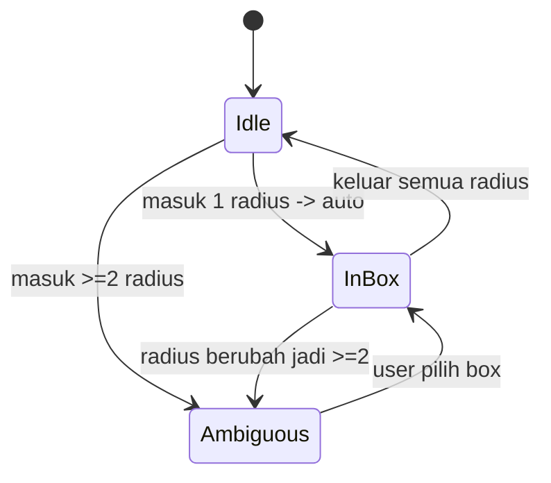

# WORLD MODE — Rencana Implementasi (Pixel Jamming World)

> Status: **SEMUA FASE SELESAI (1–5)** (commit `ec0a790`, `de0d56e`, `6f844ae`, `7323794`)
> Basis commit: `be77d8b` · Dibuat: 2026-09-28 · Diperbarui: 2026-09-29
> Fitur ini besar. Dokumen ini adalah sumber kebenaran (source of truth) sebelum koding.

---

## 0. Progres implementasi

| Fase | Isi | Status | Commit |
|---|---|---|---|
| 1 | Presence: peta pixel, avatar jalan, snapshot 15Hz + interpolasi | ✅ Selesai | `ec0a790` || 2 | Tikar + radius + zone enter/exit + kontrol owner/everyone | ✅ Selesai | `de0d56e` |
| 3 | Overlap dialog, pickup, auto-despawn tikar kosong | ✅ Selesai | `de0d56e`, `6f844ae` |
| 4 | Minimap, emote, chat world, crown owner | ✅ Selesai | `6f844ae` |
| 5 | Proximity audio fade (volume mengikuti jarak ke tikar) | ✅ Selesai | `7323794` |
| 6 | Visual daylight + animasi WorkAdventure (bob, partikel, bubble, zoom, dekorasi) | ✅ Selesai | — |
| — | Multi-world sharding & interest management | ⏸ Belum perlu (<40 user) | — |

**Belum diimplementasi (sengaja):** multi-world sharding/interest management,
persistensi posisi & tikar antar restart, voice/PTT per tikar, anti-cheat
gerakan lanjutan.

---

## 1. Ringkasan

Menambah **mode room baru** di samping mode legacy yang sudah ada:

| Mode | Deskripsi |
|---|---|
| `legacy` | Room yang ada sekarang (queue, Bank Musik, chat, soundboard, mini game). **Tidak diubah.** |
| `world` | Peta pixel-art realtime. Avatar emoji jalan bebas. **World tidak punya musik.** |
| `box` | Sesi audio (tikar). Tersembunyi dari lobby. Selalu milik sebuah `world`. |

User membuat room dan memilih mode **Legacy** atau **World**. Di dalam World,
setiap user bisa **gelar tikar** (jamming box) di posisinya. Tikar punya radius;
user lain yang masuk radius otomatis join audio + chat tikar tersebut.

---

## 2. Keputusan desain (FINAL)

Keputusan yang sudah dikunci oleh pemilik produk:

1. **World tidak punya musik.** Semua musik hanya ada di tikar.
2. **Maks 20 user per world** (v1).
3. **Tikar overlap** → munculkan **confirmation dialog** ke user yang masuk radius,
   menampilkan daftar tikar yang sedang dia masuki, user memilih mau join yang mana.
4. **Kontrol tikar bisa dikonfigurasi owner** saat gelar tikar:
   - `owner` → hanya pembuat tikar yang bisa kontrol musik
   - `everyone` → siapa saja yang ada di tikar boleh kontrol musik
5. **Aset pixel belum ada** → harus dibuat dari nol (generator/prosedural, lihat §9).

---

## 3. Model data

```sql
-- Migrasi aditif; default legacy -> data lama aman.
ALTER TABLE rooms ADD COLUMN mode TEXT DEFAULT 'legacy';         -- legacy|world|box
ALTER TABLE rooms ADD COLUMN parent_world_id TEXT NULL;          -- box -> world
ALTER TABLE rooms ADD COLUMN map_json TEXT NULL;                 -- world saja
ALTER TABLE rooms ADD COLUMN box_control TEXT DEFAULT 'everyone';-- owner|everyone

CREATE INDEX IF NOT EXISTS idx_rooms_mode ON rooms(mode, parent_world_id);

CREATE TABLE IF NOT EXISTS world_boxes (
    id              TEXT PRIMARY KEY,
    world_id        TEXT NOT NULL,
    room_id         TEXT NOT NULL UNIQUE,   -- rooms.id (mode=box) = sesi audio
    owner_device_id TEXT NOT NULL,
    label           TEXT NOT NULL,
    x               REAL NOT NULL,
    y               REAL NOT NULL,
    radius          REAL NOT NULL DEFAULT 120,
    control_mode    TEXT NOT NULL DEFAULT 'everyone', -- owner|everyone
    empty_since     DATETIME NULL,
    created_at      DATETIME DEFAULT CURRENT_TIMESTAMP,
    FOREIGN KEY (world_id) REFERENCES rooms(id) ON DELETE CASCADE
);
CREATE INDEX IF NOT EXISTS idx_boxes_world ON world_boxes(world_id);
```

**Posisi avatar TIDAK masuk DB.** In-memory + snapshot JSON
(`data/runtime_worlds.json`), pola sama seperti `runtime_rooms.json`.

**Chat/musik**: `chat_messages`, `room_queue`, `room_playlist` dipakai ulang per `box.room_id`.

---

## 4. Alur radius & overlap

Dijalankan server tiap tick. Untuk tiap avatar, hitung tikar yang radiusnya memuat dia:

```
inside = [ box | hypot(ax-bx, ay-by) <= box.radius ]
```

- `inside.length === 0` → `zone.exit` (audio berhenti, sunyi)
- `inside.length === 1` → auto `zone.enter` (mulus, tanpa dialog)
- `inside.length >= 2` → **server kirim `zone.choice_required { boxes: [...] }`**;
  klien menampilkan dialog konfirmasi; user memilih; klien balas `zone.select { box_id }`;
  server set `active_box_id`. **Server tetap validasi** bahwa box itu memang sedang
  memuat avatar (anti-spoof).

Avatar hanya punya **satu** `active_box_id` → tidak pernah dengar 2 musik sekaligus.
Menutup dialog tanpa memilih → tetap di tikar terakhir (`active_box_id` tidak berubah).



---

## 5. Netcode gerakan

| Komponen | Nilai |
|---|---|
| Klien kirim posisi | 12–15 Hz (throttled) |
| Server tick (snapshot) | 15 Hz |
| Client render | 60 fps (requestAnimationFrame) |
| Interpolasi buffer | ~100 ms |
| Local prediction | Ya (gerakan sendiri instan) |

- Klien **prediksi** gerakan lokal → kirim posisi.
- Server **clamp** ke batas peta + validasi collider → taruh di tick berikutnya.
- Server broadcast **satu snapshot kompak** semua avatar: `[id,x,y,dir,emoji,flags]`.
- Klien lerp avatar lain antar snapshot.
- Snapshot 20 user ≈ 600–700 byte × 15 Hz ≈ **~10 KB/s per klien**. Aman untuk v1.

Implementasi daemon: tambah `$loop->addPeriodicTimer(1/15, ...)` di `bin/websocket.php`.

---

## 6. Protokol WebSocket

Namespace baru; protokol legacy **tidak disentuh** (dibedakan oleh `clientMeta.mode`).

**Klien → Server**
- `world.move {x, y, dir}`
- `mat.place {x, y, control_mode, label}`
- `mat.pickup {box_id}`
- `zone.select {box_id}`
- `world.chat {message}` *(chat world-wide, opsional)*

**Server → Klien**
- `world.joined { world_id, map, you, boxes, avatars }`
- `world.snapshot { t, avatars, boxes }` @15 Hz
- `mat.placed { box }` / `mat.removed { box_id }`
- `zone.enter { box_id, room_id }` / `zone.exit { box_id }`
- `zone.choice_required { boxes: [...] }`
- → setelah `zone.enter`, **event room lama mengalir apa adanya**
  (`room_init`, `queue_updated`, `chat_message`, `playback`, loop, punish, dll.)

`WebSocketHandler` koneksi mode legacy berjalan **tanpa perubahan perilaku**.

---

## 7. Struktur file (rencana)

```
src/WorldManager.php        # state dunia, tick, radius resolver, snapshot
src/WorldBoxManager.php     # CRUD tikar (pakai RoomManager untuk room audio)
bin/websocket.php           # +timer tick 15Hz + restoreRuntimeWorlds
public/js/world/            # (modular, di-load hanya saat mode world)
  world-engine.js           # loop, input, kamera
  world-net.js              # interpolasi + prediction
  world-render.js           # canvas pixel-art
  world-zones.js            # dialog overlap, join/keluar tikar
  world-ui.js               # tombol gelar tikar, joystick mobile
api/worlds.php              # create/list world (mode=world)
public/img/world/           # tileset hasil generate (§9)
docs/WORLD_MODE_PLAN.md     # dokumen ini
```

---

## 8. Roadmap bertahap (WAJIB disiplin)

| Fase | Isi | Status |
|---|---|---|
| **1** | Presence: peta pixel, jalan bareng, snapshot+interpolasi. **Tanpa audio/tikar.** | ✅ Selesai (`ec0a790`) |
| **2** | Tikar + radius + `zone.enter/exit` → audio & chat tikar + kontrol owner/everyone. | ✅ Selesai (`de0d56e`) |
| **3** | Overlap confirmation dialog + pickup + auto-despawn tikar kosong. | ✅ Selesai (`6f844ae`) |
| **4** | Minimap, emote, joystick, chat world, crown owner. | ✅ Selesai (`6f844ae`) |
| **5** | Proximity audio fade (makin dekat makin keras), interest management, multi-world. | ✅ Fade selesai; sharding ⏸ |
| **6** | Visual daylight + animasi WorkAdventure + perbaikan layout mobile. | ✅ Selesai |

---

## 9. Aset pixel (dibuat dari nol)

Karena belum ada aset sama sekali, v1 memakai **tileset prosedural** yang digenerate
dengan skrip (tanpa dependensi art eksternal):

- Generator: `tools/generate-world-assets.php` (atau Node) → output PNG 32×32 tile ke
  `public/img/world/`.
- Tileset minimum: lantai (2–3 varian), dinding, karpet/tikar, dekorasi kecil.
- Palet terbatas (pixel-art feel), `image-rendering: pixelated`, `imageSmoothingEnabled=false`.
- Avatar = emoji pilihan user (`ctx.fillText`) — **gratis**, tidak perlu sprite per user.
- Fallback aman: kalau aset gagal dimuat → peta solid berwarna + grid (tetap bisa main).

### 9.1 Arah visual (v5 — terang, WorkAdventure-like)

Versi awal memakai latar navy gelap (`#0b0f1a`) + dinding coklat tua, sehingga world
terasa gelap & suram. Sejak v5 renderer memakai palet **siang hari** dan animasi yang
mengikuti rasa WorkAdventure (tetap prosedural, tanpa file gambar):

| Elemen | Perilaku |
|---|---|
| Lantai | Rumput 3 nada (`#8ed07a`/`#86c973`/`#96d883`) + bilah rumput & moss, bukan checkerboard gelap |
| Plaza spawn | Lingkaran paving pasir hangat di titik spawn → area nongkrong |
| Dinding | Hedge/kerb batu terang (`#4f9d55` + rim matahari) dengan shadow lembut |
| Dekorasi | Bunga, rumpun rumput, semak, pohon pixel (deterministik per world id) |
| Tikar | Cakram **transparan asli** (alpha 0.17–0.26, rumput tembus) + ring lingkaran + label pill; tanpa pola kotak |
| Avatar | Emoji + **walk bob** 3px, shadow menyusut saat melompat, ring putih untuk diri sendiri, flip horizontal saat menghadap kiri |
| Partikel | Debu kaki saat jalan, not musik (`♪ ♫ ♬`) naik dari tikar yang ada pendengarnya |
| Chat | **Speech bubble** di atas avatar pengirim, untuk **kedua** kanal (Chat Tikar & Chat World): auto-wrap maks 3 baris, fade 6s, layout di-cache per pesan |
| Panel chat | **Satu input + dua tab** (Chat Tikar / Chat World); tab aktif menentukan tujuan kirim |
| Kamera | Zoom 1.15–1.8 (avatar tetap terbaca) + look-ahead 26px ke arah hadap |
| Cahaya | Sunlight radial hangat + vignette hijau sangat tipis (bukan gelap) |
| Minimap | Latar rumput terang, tikar berwarna, viewport rectangle |

Palet & perilaku ini divalidasi oleh `tests/world_visual_check.mjs` (menolak palet gelap
lama, memastikan hook animasi & guard render tetap ada). Verifikasi visual manual:
buka world lalu pastikan luminansi canvas > 150 dan tidak ada pixel gelap.

---

## 10. Keamanan & batasan

- Posisi selalu divalidasi server (clamp, collider). Klien tidak dipercaya.
- `zone.select` diverifikasi terhadap radius aktual.
- Maks 20 user/world; maks N tikar/world (mis. 8) untuk cegah spam.
- Rate limit: `world.move` (posisi), `mat.place`, `world.chat`.
- Teks bubble chat **tidak pernah** dipercaya: `sanitizeBubbleText()` membuang
  control char, bidi override, zero-width, dan memotong ke 120 code point;
  `wrapBubbleLines()` membatasi 3 baris & memecah kata tanpa spasi. Diuji oleh
  `tests/world_bubble_check.mjs` (35+ asersi) termasuk payload 10k karakter,
  emoji, bidi, dan width mustahil.
- Posisi **tidak pernah** ditulis ke SQLite.
- Path aset tetap di `public/img/world/` (di-serve sebagai static, aman).
- Legacy flow tidak berubah → regresi legacy = 0.

### 10.1 Isolasi kegagalan (WAJIB)

Satu aksi world **tidak boleh** bisa menutup socket pemain. Sebelumnya
`handleWorldMessage()` dipanggil **sebelum** blok `try/catch` di `onMessage()`,
jadi exception apa pun (FK violation saat world row sudah hilang, DB busy, payload
aneh) merambat ke Ratchet → koneksi ditutup (close code `1000`). Gejalanya:
"gelar tikar langsung disconnect".

Aturan yang sekarang berlaku:

| Lapisan | Perilaku |
|---|---|
| `handleWorldMessage()` | Wrapper `try/catch(\Throwable)`: log + kirim `notice`, **tidak pernah** rethrow |
| `dispatchWorldMessage()` | Logika asli semua aksi world |
| `tickWorlds()` | Tiap world di-tick dalam `try/catch` sendiri; `maintainMats()` juga dijaga |
| `placeBox()` | Cek `rooms.id` ada sebelum insert; INSERT dibungkus `try/catch`; backing room dihapus kalau gagal; return `null` (bukan throw) |

Dijaga oleh `tests/world_socket_resilience_check.mjs` dan `tests/world_place_box_check.mjs`.

### 10.2 Antrean tikar (shared-session routing)

World mode **tidak pernah** men-set `JAMRI_APP.activeRoomId` (socket id = world id),
jadi semua pengecekan lama `player.mode === 'jamming' || activeRoomId` bernilai
**false** di dalam world. Akibatnya tombol "Cari Musik" → *Play Now* / *Add to queue*
memutar lagu **lokal** dan antrean tikar tetap kosong untuk semua orang — inilah
gejala "antrean musik di tikar gak sinkron".

Perbaikan:

| Bagian | Perilaku |
|---|---|
| `search.js#hasSharedTarget()` | True bila `activeRoomId` **atau** (`activeWorldId` **dan** `world.activeBox`) |
| Semua entry point search | Memakai `hasSharedTarget()` (Play Now, Add to Queue, Bank Musik) |
| `world.js#renderQueue()` | Mirror antrean tikar ke `JAMRI_APP.roomQueue` supaya cek duplikat akurat |
| `zone.exit` | Mengosongkan mirror (`roomQueue = []`) agar lagu lama tidak dianggap duplikat |

Dijaga oleh `tests/world_queue_sync_check.mjs`. Verifikasi end-to-end 2 user:
user B menambah lagu → A dan B sama-sama melihat 1 baris di antrean tikar,
`soloQueue` tetap 0.

### 10.3 Sinkronisasi user baru masuk tikar (late join)

Di room legacy, `ping` → `pong` membawa `track/state/position` sehingga pemain
baru langsung menyusul posisi lagu. Di world mode ini **putus di dua tempat**:

1. Handler `ping` world hanya menjawab `{ server_time }` → tidak ada heartbeat
   playback untuk dikoreksi.
2. `world.js#connect()` melakukan `client.listeners = {}` lalu **tidak pernah**
   mem-bind `pong` → jawaban server (kalau ada) diabaikan.

Akibatnya user yang masuk tikar saat lagu berjalan mulai dari 0:00 dan tidak
pernah mengejar yang lain.

Perbaikan:

| Bagian | Perilaku |
|---|---|
| `ping` (world) | Membalas `pong` + `position`, `state`, `track`, `box_id`, `room_id` untuk tikar aktif |
| `world.js` → `ws.on('pong')` | `syncJammingState(...)` tiap 5 detik **hanya** saat `activeBox` ada dan tab terlihat |
| `onRoomInit()` | Seed `serverBasePos`/`serverSyncTime`, mulai lagu di `position` server, lalu re-apply di 900 ms & 2200 ms (YT bridge sering belum siap) |
| `track_change` | Ikut menyimpan `state`/`position` server sebelum `playTrack` |

Dijaga oleh `tests/world_playback_sync_check.mjs`. Verifikasi 2 user:
A memutar lagu (8 detik berjalan) → B masuk tikar → B mulai di **10 detik**
(ikut berjalan), dan saat A *pause* di 6 detik → B masuk → B `paused` di 6 detik,
lalu ikut resume ketika A menekan play.

### 10.4 Tikar paused tidak boleh auto-play

Dua jalur membuat tikar yang sedang **paused** tiba-tiba berbunyi:

| Penyebab | Perbaikan |
|---|---|
| `playTrack()` selalu memanggil `playVideo()` | Hanya play bila `_shouldAutoPlay()` (server state `playing`); kalau tidak → `pauseVideo()` setelah `loadVideoById` di posisi yang benar |
| Autoplay-unlock memasang listener `keydown`/`click` | `_armAutoUnlock()` hanya dipasang bila server `playing`, di-*disarm* di `pause()`, dan handler-nya cek ulang state sebelum play — jadi WASD (jalan) tidak lagi memicu play |
| `pendingTrack` tidak menyimpan state | `pendingTrack.state` disimpan; `onReady` re-apply paused |

Dijaga oleh `tests/world_paused_state_check.mjs`. Verifikasi 2 user:
A pause di 5 detik → A jalan-jalan (WASD) → tetap paused 5 detik; B masuk tikar →
B `paused` di 5 detik, A tetap paused.

### 10.4b AKAR UTAMA: world mode tidak pernah "synced"

`enterWorld()` memanggil `player.setMode('solo', null)`. Akibatnya **seluruh** cabang
sinkronisasi di `player.js` (15 tempat, semuanya di-guard `mode === 'jamming'`) mati:

- `getCurrentTime()` mengembalikan jam YouTube lokal, bukan jam server → tiap perangkat
  punya timeline sendiri ("play masing-masing")
- `startTicker()` tidak memakai `serverSyncTime`, jadi timeline tidak maju walau audio
  lokal diblokir YouTube
- player tidak pernah mengirim `ping` sendiri (tidak ada resync periodik)
- `togglePlay/seek/next/prev/setLoop/shuffle/trackEnded` hanya mengubah state lokal,
  **tidak pernah** di-broadcast ke tikar
- `visibilitychange` tidak mengirim ping → setelah tab pindah, drift menetap
- `room_init` untuk tikar paused diperlakukan sebagai state lokal

Perbaikan: helper baru `player.isSynced()` (true untuk `jamming` **atau** `world` +
socket hidup), dipakai di semua 15 cabang. `enterWorld()` → `setMode('world', ws)`,
`leaveWorld()` → `setMode('solo', null)`. `app.js`, `lyrics.js`, dan `search.js` juga
memakai helper ini.

Dijaga oleh `tests/world_player_mode_check.mjs` (menolak `mode === 'jamming'` mentah di
luar helper). Verifikasi 2 user: drift `getCurrentTime()` A vs B = **0.00 detik** pada
4 sampel, termasuk setelah B keluar-masuk tikar **8 kali**.


### 10.5 Tampilan tikar

Tikar digambar sebagai **cakram transparan asli** (alpha 0.17–0.26) sehingga rumput
terlihat menembus, hanya sedikit lebih gelap dari ground. Pola *checkerboard* dan
tile 16px dihapus karena terbaca sebagai "kotak-kotak / transparansi palsu".
Sisa penanda: ring luar (lebih tebal saat aktif) + ring putus-putus tipis + label pill.
Dijaga oleh `tests/world_visual_check.mjs` (menolak `ctx.clip()` bertile dan alpha > 0.35).

### 10.6 Snapshot join yang tertunda tidak boleh menimpa state baru
`onRoomInit()` memasang `setTimeout(apply, 900)` dan `setTimeout(apply, 2200)`
supaya posisi awal menempel setelah bridge YouTube siap. Timer itu **tidak pernah
dibatalkan**, jadi kalau user play/pause/seek tepat setelah masuk tikar (atau
keluar-masuk tikar berulang), snapshot lama diterapkan ulang dan mengembalikan
state yang sudah usang — persis gejala "keluar-masuk bikin sinkronnya rusak,
jadi kaya play masing-masing".

Perbaikan: timer dilacak di `this._matApplyTimers`, dibatalkan lewat
`_clearMatApplyTimers()` pada `onRoomInit()` berikutnya, `zone.exit`, dan
`leave()`; dan `apply()` sendiri batal bila `player.serverSyncTime > wantTime`
(artinya sudah ada state yang lebih baru).

Dijaga oleh `tests/world_playback_sync_check.mjs`. Verifikasi protokol
(`tests/e2e/qa_world_pair.mjs`, 1 browser + 2 peer WS): pause → keluar-masuk 6× →
tetap `paused` di 88.36; resume@60 → `playing` 61.50; late joiner C masuk di
62.10 (+2.97 s) → proyeksi 65.07 vs B 64.56.

### 10.7 Keluar tikar = sesi bersama benar-benar berakhir

Sebelumnya `zone.exit` hanya memanggil `player.pause()` dan mengosongkan antrean.
Akibatnya setelah berjalan keluar dari tikar:

- `currentTrack` tetap lagu tikar, jadi dock masih menampilkan judulnya
- `getCurrentTime()` masih maju dari `serverBasePos + elapsed` (jam server basi),
  sehingga terlihat seperti masih memutar lagu tikar
- Bank Musik (`roomPlaylist`), daftar user, dan chat tikar tidak dibersihkan
- `search.js` masih menganggap sesi bersama (socket hidup), jadi "Putar"/"Antrean"
  bisa menarget room tikar yang sudah ditinggalkan

Perbaikan:

| Bagian | Perubahan |
|---|---|
| `player.resetSharedSession()` (baru) | Menghapus `currentTrack`, `serverBasePos/SyncTime`, `pendingSeekPos`, seek lock; state → `stopped`; emit `track_change(null)` + `time_update(0)` supaya dock & progress bar kosong. **Tidak** menyentuh volume user maupun `soloQueue`. |
| `world._resetMatLists()` (baru) | Mengosongkan antrean, Bank Musik, daftar user, chat tikar, dan mirror `roomQueue`/`roomPlaylist`. |
| `zone.exit` / `leave()` / `enter()` | Memanggil keduanya (plus `roomState = null`), sehingga masuk world selalu mulai dari kondisi bersih. |
| `room_init` | Sekarang membawa `playlist`, dan `onRoomInit()` meng-hydrate panel Bank Musik dari snapshot itu → masuk tikar lagi menampilkan isi **terkini**. |
| `playlist_updated` | Di-listen world.js (sebelumnya hanya jalur room legacy). |
| `search.hasSharedTarget()` (baru) | Menentukan **ke mana** lagu dikirim (antrean bersama vs antrean lokal) hanya dari ada/tidaknya target (room aktif atau tikar aktif) — **tidak** dari status socket, supaya aksi saat reconnect tidak nyasar ke antrean solo. |
| `pauseRoom()` (baru) | Satu-satunya tempat pause-diam-diam: menghitung posisi **sebelum** mengubah state ke `paused`; `getCurrentPosition()` hanya menambah delta saat state masih `playing`, jadi urutan lama membekukan posisi di anchor terakhir dan tikar/room yang kosong restart dari 0:00. Dipakai `detachFromRoom()` **dan** `onClose()` legacy. |
| `detachFromRoom()` | Mendelegasikan pembekuan posisi ke `pauseRoom()` (dulu menyimpan salinannya sendiri, dan `onClose()` punya salinan kedua dengan bug urutan yang sama). |

Dijaga oleh `tests/world_mat_exit_reset_check.mjs`. Verifikasi UI (1 user, 1 tikar):
`playing` di 4.01 s → keluar → dock "Tidak ada lagu yang diputar", semua panel
kosong, `getCurrentTime()` = 0 → masuk lagi → `paused` di **4.06 s** dengan
antrean + Bank Musik terisi ulang dari server. Verifikasi peer (user lain menambah
lagu saat kita di luar tikar): masuk lagi menampilkan `Peer Queued` + `Peer Bank`.
Posisi tikar kosong: `tests/e2e/qa_mat_position.mjs` → 6.00 s → keluar → masuk →
**6.55 s** (POSITION OK).

---

## 11. Kriteria sukses v1

- [x] Dua user bisa jalan-jalan bareng di peta dengan gerakan halus (<100 ms terasa).
- [x] User A gelar tikar → user B dekat → otomatis dengar musik tikar A.
- [x] Jika B masuk 2 radius → muncul dialog pilihan.
- [x] Mode kontrol `owner` vs `everyone` benar-benar ditegakkan server.
- [x] Tikar kosong hilang otomatis; room legacy tetap 100% berjalan.
- [x] 20 user di 1 world stabil tanpa lag berarti (batas server ditegakkan).
- [x] Bonus: minimap, emote, chat world, crown owner.

---

## 12. Yang sengaja DITUNDA

- Multi-world sharding & interest management (baru perlu >~40 user).
- Persistensi posisi & tikar antar restart (tikar hilang saat kosong 2 menit).
- Voice/PTT per tikar (warisan `voice_chunk` global).
- Anti-cheat gerakan lanjutan (saat ini clamp + validasi collider server).
