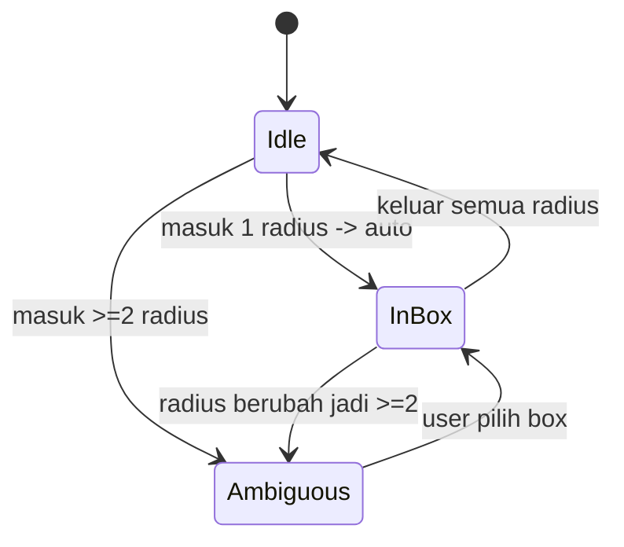

# WORLD MODE — Rencana Implementasi (Pixel Jamming World)

> Status: **SEMUA FASE SELESAI (1–5)** (commit `ec0a790`, `de0d56e`, `6f844ae`, `7323794`)
> Basis commit: `be77d8b` · Dibuat: 2026-09-28 · Diperbarui: 2026-09-29
> Fitur ini besar. Dokumen ini adalah sumber kebenaran (source of truth) sebelum koding.

---

## 0. Progres implementasi

| Fase | Isi | Status | Commit |
|---|---|---|---|
| 1 | Presence: peta pixel, avatar jalan, snapshot 15Hz + interpolasi | ✅ Selesai | `ec0a790` |
| 2 | Tikar + radius + zone enter/exit + kontrol owner/everyone | ✅ Selesai | `de0d56e` |
| 3 | Overlap dialog, pickup, auto-despawn tikar kosong | ✅ Selesai | `de0d56e`, `6f844ae` |
| 4 | Minimap, emote, chat world, crown owner | ✅ Selesai | `6f844ae` |
| 5 | Proximity audio fade (volume mengikuti jarak ke tikar) | ✅ Selesai | `7323794` |
| — | Multi-world sharding & interest management | ⏸ Belum perlu (<40 user) | — |

**Belum diimplementasi (sengaja):** multi-world sharding/interest management,
persistensi posisi & tikar antar restart, voice/PTT per tikar, anti-cheat
gerakan lanjutan.

---

## 1. Ringkasan

Menambah **mode room baru** di samping mode legacy yang sudah ada:

| Mode | Deskripsi |
|---|---|
| `legacy` | Room yang ada sekarang (queue, Bank Musik, chat, soundboard, mini game). **Tidak diubah.** |
| `world` | Peta pixel-art realtime. Avatar emoji jalan bebas. **World tidak punya musik.** |
| `box` | Sesi audio (tikar). Tersembunyi dari lobby. Selalu milik sebuah `world`. |

User membuat room dan memilih mode **Legacy** atau **World**. Di dalam World,
setiap user bisa **gelar tikar** (jamming box) di posisinya. Tikar punya radius;
user lain yang masuk radius otomatis join audio + chat tikar tersebut.

---

## 2. Keputusan desain (FINAL)

Keputusan yang sudah dikunci oleh pemilik produk:

1. **World tidak punya musik.** Semua musik hanya ada di tikar.
2. **Maks 20 user per world** (v1).
3. **Tikar overlap** → munculkan **confirmation dialog** ke user yang masuk radius,
   menampilkan daftar tikar yang sedang dia masuki, user memilih mau join yang mana.
4. **Kontrol tikar bisa dikonfigurasi owner** saat gelar tikar:
   - `owner` → hanya pembuat tikar yang bisa kontrol musik
   - `everyone` → siapa saja yang ada di tikar boleh kontrol musik
5. **Aset pixel belum ada** → harus dibuat dari nol (generator/prosedural, lihat §9).

---

## 3. Model data

```sql
-- Migrasi aditif; default legacy -> data lama aman.
ALTER TABLE rooms ADD COLUMN mode TEXT DEFAULT 'legacy';         -- legacy|world|box
ALTER TABLE rooms ADD COLUMN parent_world_id TEXT NULL;          -- box -> world
ALTER TABLE rooms ADD COLUMN map_json TEXT NULL;                 -- world saja
ALTER TABLE rooms ADD COLUMN box_control TEXT DEFAULT 'everyone';-- owner|everyone

CREATE INDEX IF NOT EXISTS idx_rooms_mode ON rooms(mode, parent_world_id);

CREATE TABLE IF NOT EXISTS world_boxes (
    id              TEXT PRIMARY KEY,
    world_id        TEXT NOT NULL,
    room_id         TEXT NOT NULL UNIQUE,   -- rooms.id (mode=box) = sesi audio
    owner_device_id TEXT NOT NULL,
    label           TEXT NOT NULL,
    x               REAL NOT NULL,
    y               REAL NOT NULL,
    radius          REAL NOT NULL DEFAULT 120,
    control_mode    TEXT NOT NULL DEFAULT 'everyone', -- owner|everyone
    empty_since     DATETIME NULL,
    created_at      DATETIME DEFAULT CURRENT_TIMESTAMP,
    FOREIGN KEY (world_id) REFERENCES rooms(id) ON DELETE CASCADE
);
CREATE INDEX IF NOT EXISTS idx_boxes_world ON world_boxes(world_id);
```

**Posisi avatar TIDAK masuk DB.** In-memory + snapshot JSON
(`data/runtime_worlds.json`), pola sama seperti `runtime_rooms.json`.

**Chat/musik**: `chat_messages`, `room_queue`, `room_playlist` dipakai ulang per `box.room_id`.

---

## 4. Alur radius & overlap

Dijalankan server tiap tick. Untuk tiap avatar, hitung tikar yang radiusnya memuat dia:

```
inside = [ box | hypot(ax-bx, ay-by) <= box.radius ]
```

- `inside.length === 0` → `zone.exit` (audio berhenti, sunyi)
- `inside.length === 1` → auto `zone.enter` (mulus, tanpa dialog)
- `inside.length >= 2` → **server kirim `zone.choice_required { boxes: [...] }`**;
  klien menampilkan dialog konfirmasi; user memilih; klien balas `zone.select { box_id }`;
  server set `active_box_id`. **Server tetap validasi** bahwa box itu memang sedang
  memuat avatar (anti-spoof).

Avatar hanya punya **satu** `active_box_id` → tidak pernah dengar 2 musik sekaligus.
Menutup dialog tanpa memilih → tetap di tikar terakhir (`active_box_id` tidak berubah).



---

## 5. Netcode gerakan

| Komponen | Nilai |
|---|---|
| Klien kirim posisi | 12–15 Hz (throttled) |
| Server tick (snapshot) | 15 Hz |
| Client render | 60 fps (requestAnimationFrame) |
| Interpolasi buffer | ~100 ms |
| Local prediction | Ya (gerakan sendiri instan) |

- Klien **prediksi** gerakan lokal → kirim posisi.
- Server **clamp** ke batas peta + validasi collider → taruh di tick berikutnya.
- Server broadcast **satu snapshot kompak** semua avatar: `[id,x,y,dir,emoji,flags]`.
- Klien lerp avatar lain antar snapshot.
- Snapshot 20 user ≈ 600–700 byte × 15 Hz ≈ **~10 KB/s per klien**. Aman untuk v1.

Implementasi daemon: tambah `$loop->addPeriodicTimer(1/15, ...)` di `bin/websocket.php`.

---

## 6. Protokol WebSocket

Namespace baru; protokol legacy **tidak disentuh** (dibedakan oleh `clientMeta.mode`).

**Klien → Server**
- `world.move {x, y, dir}`
- `mat.place {x, y, control_mode, label}`
- `mat.pickup {box_id}`
- `zone.select {box_id}`
- `world.chat {message}` *(chat world-wide, opsional)*

**Server → Klien**
- `world.joined { world_id, map, you, boxes, avatars }`
- `world.snapshot { t, avatars, boxes }` @15 Hz
- `mat.placed { box }` / `mat.removed { box_id }`
- `zone.enter { box_id, room_id }` / `zone.exit { box_id }`
- `zone.choice_required { boxes: [...] }`
- → setelah `zone.enter`, **event room lama mengalir apa adanya**
  (`room_init`, `queue_updated`, `chat_message`, `playback`, loop, punish, dll.)

`WebSocketHandler` koneksi mode legacy berjalan **tanpa perubahan perilaku**.

---

## 7. Struktur file (rencana)

```
src/WorldManager.php        # state dunia, tick, radius resolver, snapshot
src/WorldBoxManager.php     # CRUD tikar (pakai RoomManager untuk room audio)
bin/websocket.php           # +timer tick 15Hz + restoreRuntimeWorlds
public/js/world/            # (modular, di-load hanya saat mode world)
  world-engine.js           # loop, input, kamera
  world-net.js              # interpolasi + prediction
  world-render.js           # canvas pixel-art
  world-zones.js            # dialog overlap, join/keluar tikar
  world-ui.js               # tombol gelar tikar, joystick mobile
api/worlds.php              # create/list world (mode=world)
public/img/world/           # tileset hasil generate (§9)
docs/WORLD_MODE_PLAN.md     # dokumen ini
```

---

## 8. Roadmap bertahap (WAJIB disiplin)

| Fase | Isi | Status |
|---|---|---|
| **1** | Presence: peta pixel, jalan bareng, snapshot+interpolasi. **Tanpa audio/tikar.** | ✅ Selesai (`ec0a790`) |
| **2** | Tikar + radius + `zone.enter/exit` → audio & chat tikar + kontrol owner/everyone. | ✅ Selesai (`de0d56e`) |
| **3** | Overlap confirmation dialog + pickup + auto-despawn tikar kosong. | ✅ Selesai (`6f844ae`) |
| **4** | Minimap, emote, joystick, chat world, crown owner. | ✅ Selesai (`6f844ae`) |
| **5** | Proximity audio fade (makin dekat makin keras), interest management, multi-world. | ✅ Fade selesai; sharding ⏸ |

---

## 9. Aset pixel (dibuat dari nol)

Karena belum ada aset sama sekali, v1 memakai **tileset prosedural** yang digenerate
dengan skrip (tanpa dependensi art eksternal):

- Generator: `tools/generate-world-assets.php` (atau Node) → output PNG 32×32 tile ke
  `public/img/world/`.
- Tileset minimum: lantai (2–3 varian), dinding, karpet/tikar, dekorasi kecil.
- Palet terbatas (pixel-art feel), `image-rendering: pixelated`, `imageSmoothingEnabled=false`.
- Avatar = emoji pilihan user (`ctx.fillText`) — **gratis**, tidak perlu sprite per user.
- Fallback aman: kalau aset gagal dimuat → peta solid berwarna + grid (tetap bisa main).

---

## 10. Keamanan & batasan

- Posisi selalu divalidasi server (clamp, collider). Klien tidak dipercaya.
- `zone.select` diverifikasi terhadap radius aktual.
- Maks 20 user/world; maks N tikar/world (mis. 8) untuk cegah spam.
- Rate limit: `world.move` (posisi), `mat.place`, `world.chat`.
- Posisi **tidak pernah** ditulis ke SQLite.
- Path aset tetap di `public/img/world/` (di-serve sebagai static, aman).
- Legacy flow tidak berubah → regresi legacy = 0.

---

## 11. Kriteria sukses v1

- [x] Dua user bisa jalan-jalan bareng di peta dengan gerakan halus (<100 ms terasa).
- [x] User A gelar tikar → user B dekat → otomatis dengar musik tikar A.
- [x] Jika B masuk 2 radius → muncul dialog pilihan.
- [x] Mode kontrol `owner` vs `everyone` benar-benar ditegakkan server.
- [x] Tikar kosong hilang otomatis; room legacy tetap 100% berjalan.
- [x] 20 user di 1 world stabil tanpa lag berarti (batas server ditegakkan).
- [x] Bonus: minimap, emote, chat world, crown owner.

---

## 12. Yang sengaja DITUNDA

- Multi-world sharding & interest management (baru perlu >~40 user).
- Persistensi posisi & tikar antar restart (tikar hilang saat kosong 2 menit).
- Voice/PTT per tikar (warisan `voice_chunk` global).
- Anti-cheat gerakan lanjutan (saat ini clamp + validasi collider server).
